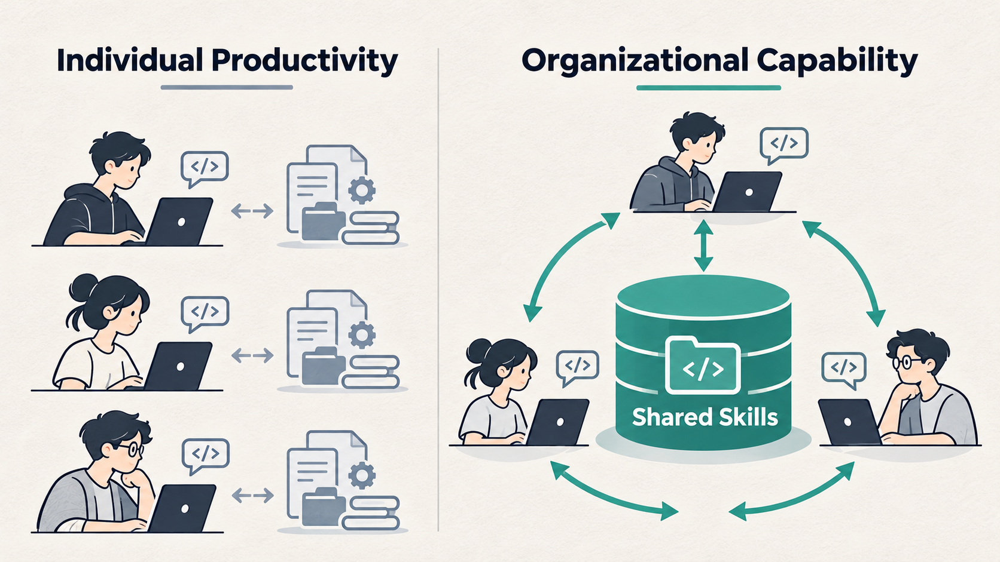
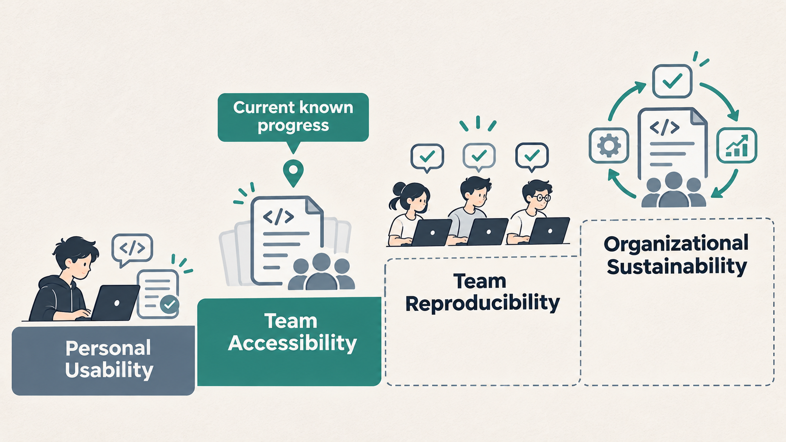
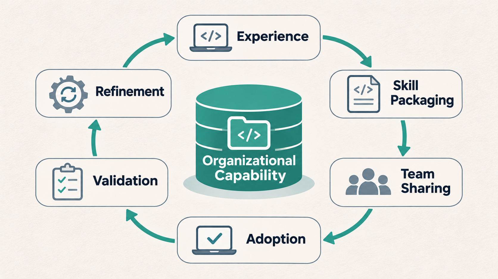

## 一、讓我驚訝的不是 Uber 的 5,000 個 Skills

最近，我讀了 Uber Engineering 發表的一篇文章：[How Uber Evals 1 Million Agent Skill Invocations a Month](https://www.uber.com/us/en/blog/optimizing-ubers-agent-skills/)。

Uber 的共用 Skill Marketplace 在一年內，從 2025 年 10 月僅有一個 Skill，成長至超過 5,000 個，單月呼叫次數更突破了 100 萬次。

這些數字確實令人印象深刻，但真正讓我感到驚訝的，並不是 Uber 已經建立了多少個 Skills，而是他們如何看待這些 Skills。

✨ **他們不只是鼓勵員工建立與分享 Skills，還建立了分層管理、跨 Agent 分發、品質評估與持續改善的機制，甚至會淘汰因模型進步而不再必要的 Skills。**

這讓我想起自己先前寫過的一篇文章：[你不必刻意發明 Skill：把一次成功的 AI 協作，變成可重複的工作經驗](/posts/turn-work-experience-into-ai-skills)。

當時，我所關注的是如何將一次成功的 AI 協作，轉化為未來可以重複使用的工作經驗，讓我們不必每次遇到類似問題時，都重新摸索如何與 AI 協作。

然而，閱讀 Uber 的文章之後，我開始思考另一個層次的問題。

當一位工程師已經將自己的工作經驗整理成 Skill，接下來呢？

這份 Skill 是否能讓其他工程師受益？當原本建立 Skill 的人不再參與時，團隊是否仍然具備維護與改善它的能力？

這些問題，已經不只是如何建立一個好的 Skill，而是如何讓個人的工作經驗，逐漸成為整個團隊的能力。

從這個角度來看，Uber 正在做的事情，或許不只是提升員工使用 AI 的效率。

> 他們正在嘗試建立一套讓組織能力得以累積、驗證與持續演進的機制。

而這才是整篇文章最吸引我的地方。

## 二、從使用 AI 到工程化 AI 能力

當 Skills 的數量從個位數成長到數千個，原本建立與使用 Skill 的問題，也會逐漸演變成管理與治理的問題。

哪些 Skills 值得推薦給其他人？哪些應該成為組織共同遵循的工作方式？又該如何確保它們在不同的 Agent 環境中仍然有效？

Uber 的做法，讓我看到了許多熟悉的軟體工程思維。

### 不是所有 Skills 都需要成為組織標準

Uber 依照適用範圍與品質要求，建立了 Domain、Core 與 Always-on 三個管理層級，讓領域團隊可以自主貢獻，同時對廣泛使用的 Skills 採取更嚴格的品質管理。

這與我們平常管理軟體元件的方式相當類似。

💡 **一個專案內部的工具函式，與一個提供給整間公司使用的共用函式庫，雖然都可能解決相同類型的問題，但兩者在測試、相容性與維護承諾上的要求，自然不會完全相同。**

當一份 Skill 的使用範圍逐漸擴大，所需要承擔的品質責任也應隨之增加。

此外，Uber 透過 Git Repository 與內部 CLI 工具 `aifx`，處理不同 Agent 環境之間的 Skill 安裝與設定差異。

這個做法的意義，在於組織累積的工作經驗，不必完全依附於某一個特定的 AI 工具。

即使未來使用的模型或 Agent 發生變化，這些知識仍有機會被保留與重新運用，當然，實際的相容性仍然需要驗證。

### 如何證明一個 Skill 真的有價值？

Uber 的文章中，另一個讓我特別感興趣的部分，是他們如何評估 Skills。

**一個 Skill 能夠正常執行，並不代表它真的改善了 AI 的表現。**

Uber 針對一個資料倉儲查詢 Skill，進行了 Ablation Test（消融實驗），比較相同任務在有無 Skill 的情況下，執行結果有何差異。

實驗結果顯示：

| 衡量項目 | 實驗結果                             |
| -------- | ------------------------------------ |
| 答案品質 | 使用 Skill 的答案獲得 87% 的比較勝率 |
| 工具呼叫 | 未使用 Skill 時增加 13%              |
| 工具錯誤 | 未使用 Skill 時為六倍                |
| 執行時間 | 未使用 Skill 時增加 31%              |

這裡的 87% 指的是比較實驗中的勝率，而不是任務成功率提升了 87%。

同時，這也只是一個特定 Skill 的評估結果，不能直接推論所有 Skills 都具有相同的效益。

但比起數字本身，我更在意的是 Uber 如何設計評估方式。

✨ **他們提出的 Evals 測試案例組成建議，是將少量固定輸入與預期輸出的 Golden Cases（約 5%），搭配大量真實任務的執行軌跡評估（約 80%），以及由作者判斷的案例（約 15%）。**

這樣的設計反映出 Agent Skills 與傳統程式測試之間的一項差異。

我們不一定能為每一個任務定義唯一正確的答案，但仍然可以從不同角度評估它：

- **Outcome Evaluation（結果評估）：** 最終產出是否符合任務需求與品質標準？
- **Trajectory Evaluation（執行過程評估）：** AI 是否以合理的順序使用必要的工具與工作流程？

即使最終得到正確的答案，執行過程仍可能包含不必要的操作、錯誤的工具選擇，甚至違反原本的工作限制。

因此，在評估 Agent Skills 時，除了關注結果，也有必要理解它是如何完成任務的。

這些評估當然也有成本，評審本身可能存在判斷差異，模型的輸出也不一定完全穩定。

但透過這樣的機制，團隊至少有機會從「我覺得這個 Skill 很好用」，逐步走向「我們有一些證據，能夠說明這個 Skill 為什麼值得使用」。

### Skills 也有生命週期

Uber 透過 Skill Workshop 管理 Skills 的生命週期，並利用使用情況、成本、延遲與錯誤等資訊，協助作者持續改善。

此外，他們也建立了 Skill Discovery（技能探索）機制，讓使用者能從大量 Skills 中找到適合自己任務的工作流程。

這一點很重要。

💡 **即使組織已經累積了大量有價值的 Skills，如果員工不知道它們的存在，或者無法在需要的時候找到它們，那麼這些知識就很難真正發揮價值。**

當然，使用 Skill 本身也不是沒有成本。

額外的指示、工具呼叫與執行結果，都可能增加 Context 的負擔。隨著模型能力改善，過去必要的指示也可能逐漸變得多餘。

因此，持續改善不一定意味著增加更多內容，有時候反而需要刪除不必要的規則，甚至淘汰整個 Skill。

這些做法讓我意識到，Uber 並不是單純建立了一個存放 Skills 的地方，而是在嘗試管理這些 Skills 的完整生命週期。

✨ **當 Skills 開始被當作具有生命週期的工程資產來管理時，AI 的應用就不再只是個人如何使用工具的問題，而逐漸成為組織如何發展自身能力的問題。**

## 三、當個人生產力提升，組織能力也跟著成長了嗎？

從我目前所處的軟體工程團隊來看，使用 AI 協助日常開發，已經逐漸成為一件很自然的事情。

工程師會使用 AI 分析問題、撰寫程式碼、研究技術方案，也會在這些過程中，逐漸摸索出適合自己的協作方式。

有人擅長讓 AI 協助分析複雜的程式碼，有人建立了有效的問題排查流程，也有人逐漸發展出一套與 Coding Agent 協作的開發模式。

這些經驗都可能提升個人的工作效率。

但如果我們將觀察的範圍從個人擴大到整個團隊，就會出現另一個值得思考的問題。

❓ **當每一位工程師都因為 AI 而變得更有效率時，團隊的能力是否也以相同的方式成長？**

個人生產力的提升，當然可能改善團隊的整體產出。

但整體產出的增加，與團隊是否具備可持續累積的能力，並不是完全相同的事情。

  個人生產力可以提升整體產出，而經過驗證與共享的工作經驗，則有機會進一步形成組織能力

假設團隊中有一位工程師，已經摸索出一套非常有效的套件升級影響評估方式。

他知道應該如何引導 AI 查閱官方文件、識別 Breaking Changes、分析程式碼中的實際使用情況，以及設計後續的驗證方式。

每當遇到類似的任務，他都能透過 AI 快速完成工作。

然而，如果這套工作方式只有他自己知道，其他工程師遇到相同問題時，仍然需要各自摸索，那麼這份能力就仍然高度依賴個人。

即使團隊中的每個人都在使用 AI，也可能只是各自建立了一套有效的工作方式。

這並不是壞事，卻意味著我們可能正在重複投入一些原本有機會共享的學習成本。

💡 **我認為，組織能力有一個很重要的特徵：它不應該完全依賴某一位成員是否在場。**

當一位工程師累積的經驗，能夠被其他成員理解、運用，甚至進一步改善時，這份經驗才有機會從個人能力，逐漸轉化為組織能力。

而 Agent Skills 為這樣的轉變，提供了一種新的可能性。

過去，我們透過文件、教育訓練、Pair Programming 或 Code Review，將工作經驗傳遞給其他工程師。

現在，我們也有機會將其中一部分經驗整理成 AI Agent 可以運用的知識，讓其他成員在實際執行任務時，直接使用這些已經累積的工作方式。

這並不代表工程師不再需要理解背後的知識，也不代表 Skills 可以取代既有的經驗傳承方式。

但它讓經驗的傳遞，多了一個能夠直接融入日常工作流程的管道。

## 四、從個人 Skill 到組織能力，中間還缺了什麼？

在先前的文章中，我曾經分享過自己建立的 `presentation-flow-writer`。

為了減少 AI 生成簡報過程中的重工，我逐漸發展出一套先規劃簡報流程、再交由 AI 生成初版簡報的工作方式，並將這些經驗整理成可以重複使用的 Skill。

關於這個 Skill 的建立過程，我已經在上一篇文章中有較完整的說明。

這次，我想談的是建立 Skill 之後的事情。

目前，我仍然持續使用這個 Skill，也曾經將它分享給團隊成員。

但如果問我，其他成員是否真的使用過它？是否也能透過它改善自己的簡報製作流程？或者是否有人根據自己的使用經驗，進一步改善這個 Skill？

坦白說，我目前並不清楚。

這也讓我重新思考，當我將一份 Skill 分享給其他人時，究竟完成了什麼？

我確實將原本存在於個人工作經驗中的一部分知識，整理成其他人有機會使用的形式。

但這份知識是否已經成為團隊的能力，卻是另一個問題。

### 可共享的知識，不等於組織能力

為了理解兩者之間的差異，我嘗試將 Skill 從個人使用走向組織能力的過程，區分為四個階段。

| 階段       | 說明                                                     |
| ---------- | -------------------------------------------------------- |
| 個人可用   | 建立者能夠透過 Skill 重複完成工作。                      |
| 團隊可取得 | 其他成員知道 Skill 的存在，並且有管道取得它。            |
| 團隊可重現 | 其他成員能在適用的工作情境中，取得符合預期的結果。       |
| 組織可持續 | 即使原作者不再參與，團隊仍然能維護、驗證與改善這份能力。 |

這不是一套正式的成熟度模型，而是我用來理解 Skill 與組織能力之間關係的一個簡單框架。

  從個人 Skill 到組織能力的四個階段。分享只是其中的一個環節，而不是轉化的終點

以 `presentation-flow-writer` 為例，目前我所掌握的資訊，大致只到第二個階段。

它已經具備個人使用的價值，也曾經被分享給團隊，但是否能在其他成員的工作情境中重現類似的效果，目前仍缺乏足夠的資訊。

從分享走向實際採用，中間可能存在許多容易被忽略的問題。

❓ **其他成員是否知道什麼時候適合使用這個 Skill？是否能方便地找到與安裝它？是否理解它的輸出方式？又或者，他們原本的工作流程就已經足夠有效，因此沒有使用它的必要？**

這些問題不一定代表 Skill 本身存在缺陷。

它們也可能反映出不同成員的工作需求、使用習慣與工具環境有所差異。

因此，並不是每一個對自己有價值的 Skill，都需要成為團隊共同使用的 Skill。

但如果我們希望某一份 Skill 能夠成為組織資產，就不能只停留在「我已經分享給大家了」。

還需要進一步確認，這份知識是否真的能夠被其他人運用，以及是否值得由團隊共同維護。

## 五、為什麼累積 Skills 是一個工程文化問題？

在閱讀 Uber 的文章之前，我比較常從個人的角度思考 Skills。

如何讓自己的工作流程更有效率？如何避免重複摸索？如何讓 AI 更理解我希望它採取的工作方式？

但當我們開始討論組織能力時，問題就不再只是個人如何使用 AI。

它也涉及團隊如何看待知識貢獻、工作時間、品質責任與長期維護。

### 建立者承擔成本，團隊共享收益

一位工程師完成自己的工作之後，如果希望將過程中的經驗整理成其他人也能使用的 Skill，往往必須投入額外的時間。

除了整理原本的工作流程，可能還需要移除只適用於自身環境的假設、補充使用說明、處理不同情境，以及設計驗證方式。

如果這個 Skill 後來被其他成員使用，所帶來的收益可能分散在整個團隊之中。

但建立與整理的成本，往往先由原本的工程師承擔。

這其實與我們過去建立共用函式庫、改善開發工具或撰寫技術文件時，面對的問題相當類似。

對個人而言，直接完成眼前的任務，可能是最有效率的選擇。

對組織而言，適度投入時間將這些經驗整理成可重複使用的資產，卻可能具有更長期的價值。

兩者之間並不一定會自然取得平衡。

如果團隊的工作安排始終只關注眼前的交付成果，卻沒有為共用能力的改善保留空間，那麼即使工程師具備建立 Skills 的能力，也未必能持續投入。

💡 **因此，我認為值得思考的，不只是如何鼓勵工程師建立 Skills，而是團隊是否將這類知識貢獻視為工程工作的一部分。**

### 共享之後，誰來承擔品質責任？

當一份 Skill 只供自己使用時，即使內容有所不足，建立者通常也能透過自身經驗進行補充。

但當它開始被其他成員使用，情況就不同了。

其他使用者可能不具備相同的背景知識，也不一定知道哪些指示已經過時，或者哪些操作只適用於特定環境。

如果一份 Skill 包含了錯誤的假設，AI 可能會將這些假設帶入每一次相關的任務。

原本只影響一個人的問題，就有可能透過共享而影響更多人。

特別是涉及程式碼修改、系統操作或敏感資訊的工作流程，Skill 本身也不能取代原有的權限控管、安全措施與人工審查。

這也是為什麼，我特別認同 Uber 對不同使用範圍的 Skills 採取不同管理方式的做法。

一份個人實驗性質的 Skill，與一份團隊共同依賴的 Skill，不應該承擔完全相同的品質要求。

但當團隊開始依賴某一份 Skill 時，就需要思考誰負責維護、如何處理問題回報，以及什麼情況下應該停止使用它。

### Skills 也可能累積技術債

在軟體工程領域，我們早已熟悉 Technical Debt（技術債）的概念。

我認為，Skills 也可能出現類似的現象。不妨借用這個概念，將它稱為 Skill Debt（技能債）。

例如：

- Skill 所依賴的工具或 API 已經發生變化。
- 工作流程仍然遵循已經淘汰的技術規範。
- 不同 Skills 對相同任務提供彼此衝突的指示。
- 原本建立 Skill 的成員已經不再負責相關工作。
- 模型能力已經改善，但 Skill 仍然保留大量不必要的限制。

這些問題不一定會在 Skill 建立時出現，卻可能隨著時間逐漸累積。

💡 **如果團隊只鼓勵建立新的 Skills，卻沒有相應的維護與淘汰機制，那麼 Skills 的數量愈多，反而可能帶來更多管理成本。**

因此，建立 Skills 並不應該成為另一種追求數量的工程活動。

真正值得建立的文化，是讓有價值的經驗能夠被留下，讓有效的能力能夠被共享，也讓不再適用的知識能夠被修正或移除。

## 六、不必成為 Uber，也能開始累積組織能力

Uber 的規模與一般軟體工程團隊存在很大的差異。

我們不一定需要建立一個 Skill Marketplace，也不一定需要投入資源打造專門的評估平台。

但這並不代表，我們無法從中借鏡一些適合自身規模的做法。

如果要從現有的工程團隊開始嘗試，我會傾向先建立一套最小可行的 Skill 共享與維護機制。

### 1. 讓值得共享的 Skills 有一個共同的位置

最簡單的方式，可能就是建立一個團隊共用的 Git Repository。

將具有共享價值的 Skills 集中管理，並提供基本的使用說明，包括適用情境、必要的工具環境，以及已知的限制。

不一定要將每位工程師建立的所有 Skills 都放進來。

✨ **個人可以保留自己的實驗性 Skills，而那些已經具有一定使用價值、值得讓其他成員嘗試的 Skills，再進入團隊共用的範圍。**

### 2. 讓其他成員參與驗證

當一份 Skill 準備被團隊共同使用時，可以邀請其他成員透過真實任務進行驗證。

這個過程的價值，在於找出那些建立者可能沒有意識到的隱含條件。

例如，某個 Skill 在建立者的開發環境中運作良好，但其他成員使用不同的 Agent、作業系統或專案架構時，可能就會遇到問題。

也可能是原本看似清楚的工作流程，實際上仍然依賴建立者提供額外的判斷。

✨ **透過其他成員的使用經驗，我們才有機會確認這份 Skill 的適用範圍，以及它是否真的具有跨成員重複使用的價值。**

### 3. 建立與使用範圍相符的管理方式

一般團隊不一定需要直接採用 Uber 的管理架構。

但可以先區分三種狀態：

- **個人實驗：** 由建立者自行探索與使用，不承諾團隊適用性。
- **團隊共享：** 提供給其他成員嘗試與回饋，但尚未成為團隊推薦的工作方式。
- **團隊推薦：** 經過適當驗證，具有明確的適用範圍與維護責任。

這些狀態不一定需要透過額外的平台管理，也可以先使用 Repository 中的文件或目錄結構進行區分。

✨ **重要的是，使用者能夠知道自己正在使用的是一份實驗性質的 Skill，還是一份團隊已經建立一定信任的工作指引。**

### 4. 讓回饋與維護成為既有工程流程的一部分

既然 Skills 可以透過 Git 進行版本管理，我們也可以運用既有的工程協作方式來維護它們。

例如，透過 Issue 回報使用問題，透過 Pull Request 改善內容，並在必要時進行同儕審查。

每一份受到團隊依賴的 Skill，也應該有明確的維護責任，以及必要時可以停止推薦或淘汰的機制。

✨ **不必為所有 Skills 建立相同程度的管理負擔，而是根據使用範圍、可能造成的影響，以及團隊對它的依賴程度，決定需要投入多少維護成本。**

### 5. 衡量能力，而不是衡量 Skill 數量

如果團隊真的開始累積 Skills，我認為值得關注的，不是這個月新增了多少個 Skill，而是這些 Skills 是否真的改善了工作方式。

我們可以從幾個面向進行觀察：

| 衡量面向                    | 值得觀察的問題                                   |
| --------------------------- | ------------------------------------------------ |
| Adoption（採用）            | 是否真的有其他成員使用？                         |
| Portability（可移植性）     | 換一位使用者或適用的工作環境，是否仍然有效？     |
| Quality（品質）             | 是否改善了任務品質與結果的一致性？               |
| Efficiency（效率）          | 是否減少摸索、人工介入與重工？                   |
| Maintainability（可維護性） | 原作者之外，是否有人能夠理解與改善它？           |
| Net Value（淨效益）         | 帶來的收益是否大於建立、執行、驗證與維護的成本？ |

這些面向不一定都需要轉化為精確的量化指標。

💡 **對小型團隊而言，少量的真實任務比較、使用者回饋與定期檢視，就可以作為初步的判斷依據。**

甚至可以先找出一份已經具有個人使用價值的 Skill，邀請另一位成員在適合的任務中嘗試使用，觀察它是否真的能夠減少對原作者的依賴。

這就可以是很好的起點。

整個過程可以形成一個持續改善的循環。

  組織能力不是一次性的知識移轉，而是在實際使用與回饋中持續演進的過程

每一次有效的使用，都有機會成為下一次改善的依據。

這才是我所期待的組織能力累積方式。

✨ **不是每位工程師都必須建立很多 Skills，而是當有人找到更好的工作方式時，團隊有一套機制，能夠讓這份經驗被其他人運用，並且在後續的使用中持續演進。**

## 七、結語：讓個人的成功，不只是個人的成功

回顧這幾年 AI 對軟體工程工作方式帶來的改變，我們花了許多時間探索如何讓 AI 更有效地協助自己完成工作。

我們學習如何提供 Context、如何設計 Prompt、如何使用 Coding Agent，也逐漸建立適合自己的 AI 協作流程。

這些努力都具有價值。

但 Uber 的案例，讓我開始從另一個角度看待這些累積。

當 AI 已經具備協助執行工作的能力時，組織是否也具備將自身經驗轉化為 AI 可運用能力的機制？

在上一篇文章中，我所關注的是如何讓一次成功的 AI 協作，不必只發生一次。

而現在，我更想思考的是：

> 如何讓這樣的成功，不必只發生在同一個人身上。

Skills 提供了一種可能的途徑，但它們並不會因為被建立或分享，就自然成為組織能力。

我並不期待自己的團隊有一天也能累積 5,000 個 Skills。

✨ **比起這個數字，我更期待的是，當團隊中的某一位工程師找到一個更好的工作方式時，這份改善不會只停留在他自己的工作流程中。**

如果其他成員能夠在這份經驗的基礎上繼續前進，而不必重新付出相同的摸索成本，那麼每一次個人的改善，就有機會成為組織下一次改善的起點。

這或許才是 AI 為工程團隊帶來的另一種長期價值。

下一次，當我們透過 AI 成功完成一項工作時，也許可以多問自己一個問題：

**「下一次遇到類似問題的，如果不是我，而是團隊中的另一位工程師，他能否直接受益於我今天所累積的經驗？」**
